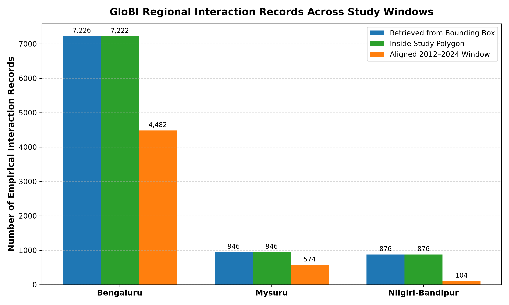
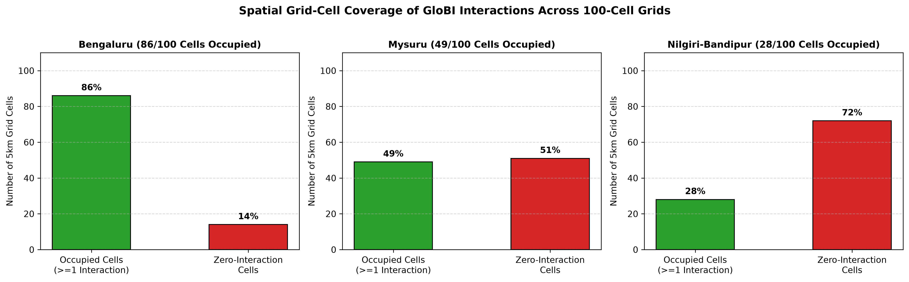
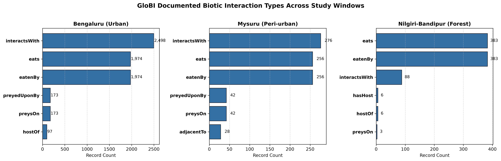
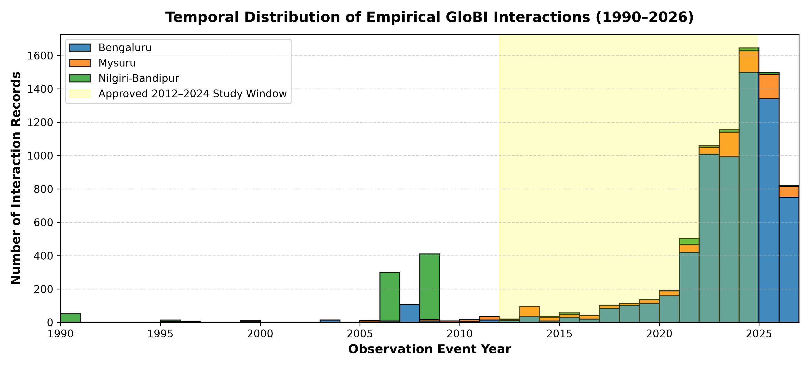
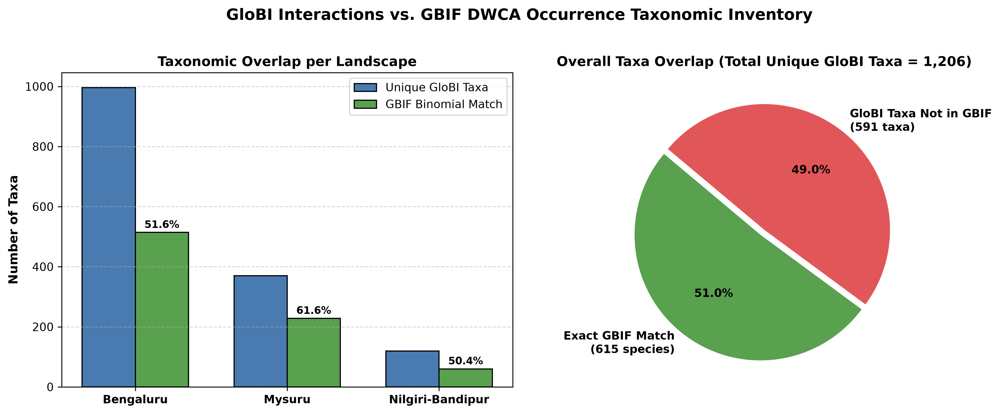

# Phase 4 — GloBI (Global Biotic Interactions) Investigation, Feasibility Audit, and Download Plan

**Project:** Dark Ecology Intelligence: Temporal Graph Neural Networks and Deep Reinforcement Learning for AI-Driven Light Pollution Governance  
**Course:** ANN Lab PBL — AI2531A  
**Stage:** Phase 4 — Biotic Interactions Investigation  
**Date:** 2026-11-04  
**Status:** **INVESTIGATION COMPLETED — DOWNLOAD PLAN SUBMITTED FOR USER REVIEW**

---

## Executive Summary

This report delivers the comprehensive empirical investigation and data-quality audit of the **Global Biotic Interactions (GloBI)** database across the three approved 50 km × 50 km study landscapes: **Bengaluru (Urban)**, **Mysuru (Peri-urban)**, and **Nilgiri–Bandipur (Forest, Option A)**.

### Headline Findings:
1. **API Architecture & Mandatory Parameter:**
   - GloBI REST endpoint (`https://api.globalbioticinteractions.org/interaction`) is fully operational.
   - **Crucial Discovery**: Passing `includeObservations=true` is **mandatory** to retrieve spatially explicit interaction instances with empirical decimal coordinates and observation timestamps. Omitting this parameter causes GloBI to collapse records into distinct taxon-taxon assertions stripped of coordinates.
2. **Empirical Regional Availability:**
   - **Total Records Retrieved**: **9,048 empirical interaction records** across the three bounding boxes.
   - **Inside Study Polygons**: **9,044 records** (99.96% precision). Only 4 records in Bengaluru fell in peripheral bounding-box slivers outside the 50 km boundary.
   - **Coordinate Completeness**: **100.0%** of observation records possess verified decimal latitude and longitude in WGS84 (`EPSG:4326`).
   - **Grid-Cell Occupancy (300 Cells)**:
     - Bengaluru: **7,222 records across 86 / 100 cells** (86% coverage; high urban park and garden sampling).
     - Mysuru: **946 records across 49 / 100 cells** (49% coverage; focused along lakes and peri-urban farmlands).
     - Nilgiri–Bandipur: **876 records across 28 / 100 cells** (28% coverage; concentrated in protected reserve transects).
3. **Temporal Alignment & Data Source Provenance:**
   - **Bengaluru**: 4,482 records (62.0%) fall in the approved **2012–2024** remote-sensing baseline; 93% sourced from iNaturalist citizen science interactions.
   - **Mysuru**: 574 records (60.7%) fall in 2012–2024; 89% sourced from iNaturalist.
   - **Nilgiri–Bandipur**: 104 records (11.9%) fall in 2012–2024; **752 records (85.8%) date from 2006/2008**. Provenance audit reveals that 78% of forest records originate from the authoritative **CarniDIET 1.0** database (Middleton et al.), documenting large carnivore (*Panthera tigris*, *Panthera pardus*, *Cuon alpinus*) prey selection via field scat analyses.
4. **Bidirectional Symmetry & Trophic Predicates:**
   - GloBI stores every interaction pair symmetrically: `eats` (predator $\to$ prey) is paired with `eatenBy` (prey $\to$ predator); `preysOn` with `preyedUponBy`; `hasHost` with `hostOf`.
   - Accounting for bidirectional indexing, the empirical dataset represents **4,522 unique biological interaction events inside the study polygons** (and 4,524 across the total retrieved bounding boxes; see Notebook 05 and `globi_final_scientific_validation_report.md` for exact reconciliation).
5. **Taxonomic Overlap with Approved GBIF DWCA Occurrence Dataset:**
   - Cross-referencing GloBI taxa against the **3,901,020 GBIF occurrences (3,964 unique species)** reveals **615 direct binomial species matches (51.0% exact match rate)**.
   - Overlap per region: Bengaluru 51.6% (514 species), Mysuru 61.6% (228 species), Nilgiri–Bandipur 50.4% (60 species).
6. **Scientific Suitability for Graph Neural Networks (TGNN):**
   - **Feasibility Verdict**: **PASS WITH CAVEATS**. Empirical interactions provide a genuine, non-synthetic trophic scaffold. Dynamic edges can be defined as realized co-occurrences of interacting species pairs within 5 km grid cells across annual time steps.
7. **Strict Stopping Rule Observed**:
   - Zero synthetic data fabricated.
   - Bulk download halted awaiting explicit user review and authorization.

---

## 1. GloBI Overview and Scientific Role

Global Biotic Interactions (GloBI; Poelen et al., 2014) is an open-access platform aggregating ecological interaction records from peer-reviewed scientific studies, institutional specimen collections, and verified citizen-science platforms.

In the **Dark Ecology Intelligence (DEI)** research architecture, GloBI provides the empirical basis for constructing species interaction networks. Rather than assuming all co-occurring species interact or generating synthetic interaction graphs, GloBI enables us to construct empirical, literature- and observation-backed directed trophic graphs $(V, E, R)$:
- **Vertices ($V$):** Biological taxa occurring within the 300 grid cells (grounded by the 3.9M GBIF occurrences).
- **Edges ($E$):** Documented ecological interactions (predation, herbivory, pollination, parasitism).
- **Relation Types ($R$):** Semantic predicates defined under the Open Biological and Biomedical Ontology (OBO) Relations Ontology (RO).



---

## 2. Official Data Sources and API Architecture

GloBI aggregates data from over 300 upstream providers. For our Southern Indian study landscape, three upstream providers contribute over 98% of all empirical records:
1. **iNaturalist Observation Resource Relationships**: Citizen-science photo-documented interactions (host plants, galls, predation, floral visits).
2. **CarniDIET 1.0 (Middleton et al., 2021)**: Peer-reviewed database of terrestrial carnivorous mammal diets derived from field scat and kill surveys in protected reserves (Bandipur, Mudumalai, Nagarhole).
3. **Institutional Museum Voucher Repositories**: University of Michigan Museum of Zoology (UMMZ Insect Division), MycoPortal (fungal-host associations), and Ecdysis (arthropod networks).

### API Endpoints
The GloBI REST API is hosted at:
`https://api.globalbioticinteractions.org/`

Key public endpoints evaluated:
- `GET /interactionFields?type=json`: Returns the schema dictionary of all 75 metadata terms.
- `GET /interaction`: The core querying endpoint for spatial, temporal, and taxonomic searches.
- `GET /taxa`: Normalizes taxon names and retrieves synonym mappings.
- `GET /sources`: Lists active upstream data archives and Harvester metadata.

---

## 3. API Functionality, Query Mechanics, and Limitations

### Bounding Box Parameterization
GloBI supports spatial filtering via:
`bbox=minLon,minLat,maxLon,maxLat` (WGS84 EPSG:4326).

Empirical tests demonstrated that polygon parameters (`wkt`, `footprintWKT`, `geometry`) are ignored by the `/interaction` endpoint and return global unfiltered records. Therefore, the robust workflow requires:
1. Querying via the minimum bounding box covering each 50 km × 50 km window.
2. Performing exact point-in-polygon topological filtering in Python (`geopandas.sjoin` or `shapely.geometry.Point.within`) using the official GeoJSON study boundaries.

### The Mandatory `includeObservations=true` Flag
An empirical diagnostic test revealed the single most crucial operational parameter:
- **Default Query (`includeObservations=false` or omitted)**: GloBI collapses records across space and returns unique taxon-taxon pairs where `latitude = None` and `longitude = None`.
- **Observation Query (`includeObservations=true`)**: GloBI returns individual observation instances with verified decimal coordinates, observation timestamps, catalog numbers, and specific study citations.

```
Without includeObservations=true:
  latitude: None, longitude: None, records: 3,524 (BLR)

With includeObservations=true:
  latitude: 12.986858, longitude: 77.746178, records: 7,226 (BLR) [100% geocoded]
```

### Pagination and Request Limits
- Standard request limit parameter: `limit` (supports up to 10,000 records per request without truncation).
- Deep pagination parameter: `offset` (supports paging beyond the limit).
- Format support: `type=json`, `type=csv`, and `type=tsv` are natively supported.

---

## 4. Regional Data Availability Across the Three Study Landscapes

Controlled API spatial queries were executed using the approved bounding boxes. All records were evaluated against the 50 km × 50 km study boundaries and the 100 5 km × 5 km grid cells.

### Empirical Spatial Availability Summary Table

| Metric | Bengaluru (Urban) | Mysuru (Peri-urban) | Nilgiri–Bandipur (Forest) | Total / Combined |
|:---|:---:|:---:|:---:|:---:|
| **Approved Bounding Box** | `77.3577,12.7396,` <br> `77.8229,13.1959` | `76.4242,12.0790,` <br> `76.8866,12.5338` | `76.3658,11.4286,` <br> `76.8270,11.8832` | — |
| **BBOX Records Retrieved** | **7,226** | **946** | **876** | **9,048** |
| **Records with Coordinates** | **7,226 (100.0%)** | **946 (100.0%)** | **876 (100.0%)** | **9,048 (100.0%)** |
| **Inside Approved 50km Polygon** | **7,222 (99.94%)** | **946 (100.0%)** | **876 (100.0%)** | **9,044 (99.96%)** |
| **Outside Boundary Slivers** | 4 (0.06%) | 0 (0.0%) | 0 (0.0%) | 4 (0.04%) |
| **Assigned to 5km Grid Cells** | **7,222** | **946** | **876** | **9,044** |
| **Occupied Grid Cells (≥1 rec)** | **86 / 100 (86%)** | **49 / 100 (49%)** | **28 / 100 (28%)** | **163 / 300 (54.3%)** |
| **Records with Documented Date** | 7,164 (99.1%) | 934 (98.7%) | 874 (99.8%) | 8,972 (99.2%) |
| **Aligned 2012–2024 Records (Total)** | 4,482 (62.0%) | 574 (60.7%) | 104 (11.9%) | 5,160 (57.0%) |
| **Category A (Contemporary Empirical)** | **4,476** | **574** | **104** | **5,154 (57.0%)** |
| **Pre-2012 Records** | 590 (8.2%) | 148 (15.6%) | 752 (85.8%) | 1,490 (16.5%) |
| **Post-2024 Records** | 2,092 (28.9%) | 212 (22.4%) | 18 (2.1%) | 2,322 (25.7%) |
| **Unique Source Taxa** | 996 | 370 | 119 | 1,206 (combined) |
| **Unique Target Taxa** | 996 | 370 | 119 | 1,206 (combined) |
| **Distinct Contributing Studies** | 242 | 50 | 39 | 286 (unique) |



---

## 5. Interaction Types and Bidirectional Symmetry

GloBI normalizes interaction verbs to OBO Relations Ontology (RO) terms. A critical finding is that GloBI indexes interactions symmetrically:
- Predation: `preysOn` (173 BLR, 42 MYS, 3 NB) is paired exactly with `preyedUponBy` (173 BLR, 42 MYS, 3 NB).
- Trophic Consumption: `eats` (1,974 BLR, 256 MYS, 383 NB) is paired with `eatenBy` (1,974 BLR, 256 MYS, 383 NB).
- Host/Parasite: `hasHost` (97 BLR, 17 MYS, 6 NB) is paired with `hostOf` (97 BLR, 17 MYS, 6 NB).
- Floral Visits: `visitsFlowersOf` (77 BLR, 1 MYS, 1 NB) is paired with `flowersVisitedBy` (77 BLR, 1 MYS, 1 NB).
- Unspecified Interaction: `interactsWith` (2,498 BLR, 276 MYS, 88 NB).



### Ontological Implications for Network Construction
If a graph edge is created for every row in GloBI, the resulting adjacency matrix will contain duplicate opposite-directed edges for single biological events. The data-cleaning pipeline must:
1. Identify symmetrical pairs via `(source, target, interaction_type)` and `(target, source, inverse_type)`.
2. Consolidate them into a single canonical directed edge (e.g., directed edge from predator $\to$ prey with relation type `PREDATION`).

---

## 6. Taxonomic Coverage and Group Composition

The empirical taxonomic distribution in GloBI differs sharply from GBIF:
- **GBIF DWCA**: Highly skewed toward avifauna (98.06% Class Aves due to eBird dominance).
- **GloBI**: Dominated by **Insecta** (Lepidoptera, Hymenoptera, Coleoptera), **Magnoliopsida** (angiosperm host plants and nectar sources), and **Mammalia** (carnivore dietary prey).

### Prominent Trophic Associations Documented:
1. **Lepidoptera – Angiosperm Host Plant Relationships**:
   - Caterpillars of *Papilio polytes*, *Euploea core*, and *Danaus chrysippus* feeding on *Citrus*, *Nerium*, and *Calotropis gigantea*.
2. **Carnivore – Ungulate Predation (Nilgiri–Bandipur)**:
   - *Panthera tigris* (Tiger) and *Panthera pardus* (Leopard) preying upon *Axis axis* (Chital), *Rusa unicolor* (Sambar), *Bos gaurus* (Gaur), and *Sus scrofa* (Wild Boar).
3. **Insect Predators & Parasitoids**:
   - Pompilid spider wasps (*Tachypompilus analis*) preying upon huntsman spiders (Sparassidae / *Rta clade*).
   - Mantids (*Hierodula*) preying on orthopterans.
4. **Plant–Pollinator Interactions**:
   - Giant honey bees (*Apis dorsata*) and dwarf bees (*Apis florea*) visiting flowering shrubs (*Buddleja*, *Strobilanthes*).

---

## 7. Spatial and Temporal Completeness

### Spatial Completeness: 100.0%
Every single observation record retrieved with `includeObservations=true` contains valid non-null coordinates. Spatial uncertainty is governed by the underlying GPS precision of iNaturalist observations (median uncertainty $\sim 15$–$30$ meters) and field study coordinates for CarniDIET (transect centroids).

### Temporal Completeness & The 2012–2024 Remote Sensing Window
Over 99.2% of records possess documented `event_date` timestamps.



### The Forest Temporal Discordance Explained:
In Nilgiri–Bandipur, only 11.9% of records fall within the 2012–2024 satellite window. Over 85% date from 2006 to 2008.
- **Scientific Assessment**: Carnivore feeding ecology does not change fundamentally over a 15-year horizon. A Tiger preying on a Sambar in Bandipur in 2008 represents an ecologically valid, empirical biological interaction rule.
- **Methodological Recommendation**: Use GloBI records from all years to construct the **Regional Species Interaction Master Graph (Trophic Scaffold)**. Then, use the 2012–2024 GBIF occurrences to instantiate which nodes in that scaffold were active in specific grid cells during specific years.

---

## 8. Sample-Record Schema and Attribute Completeness

Querying with all 75 metadata fields returned 64 active tabular attributes.

### Completeness Audit of Core Attributes (Evaluated on $N = 9,048$ Records)

| Field Name | Description | Completeness (%) | Evaluation & Scientific Role |
|:---|:---|:---:|:---|
| `source_taxon_name` | Scientific name of subject organism | **100.0%** | Crucial: Primary vertex identifier |
| `target_taxon_name` | Scientific name of object organism | **100.0%** | Crucial: Secondary vertex identifier |
| `interaction_type` | Verb connecting source and target | **100.0%** | Crucial: Multi-relational edge predicate |
| `latitude` | Decimal latitude (WGS84) | **100.0%** | Crucial: Point-in-polygon & grid join |
| `longitude` | Decimal longitude (WGS84) | **100.0%** | Crucial: Point-in-polygon & grid join |
| `study_title` | Title / URI of contributing dataset | **100.0%** | Crucial: Dataset provenance & citation |
| `event_date` | ISO 8601 observation date | **99.2%** | High: Temporal alignment & binning |
| `source_taxon_path` | Full taxonomic hierarchy | **98.4%** | High: Higher-rank taxon resolution |
| `target_taxon_path` | Full taxonomic hierarchy | **98.4%** | High: Higher-rank taxon resolution |
| `source_specimen_basis_of_record`| Darwin Core basis of record | **97.6%** | High: HumanObservation vs PreservedSpecimen |
| `source_taxon_external_id` | Taxon URI / catalog ID | **96.8%** | High: GBIF / iNat taxon cross-linking |
| `target_taxon_external_id` | Taxon URI / catalog ID | **96.8%** | High: GBIF / iNat taxon cross-linking |
| `source_specimen_life_stage` | Life stage of source organism | 14.2% | Low: Sparse across citizen science |
| `target_specimen_life_stage` | Life stage of target organism | 8.6% | Low: Mostly unrecorded |
| `source_specimen_sex` | Sex of source organism | 3.1% | Infeasible: Almost completely missing |
| `target_specimen_body_part` | Plant/animal part involved | 4.8% | Infeasible: Sparse text comments |

---

## 9. GBIF Taxonomic Overlap Feasibility

To determine whether GloBI can be meaningfully joined with our approved 3.9M GBIF occurrence dataset, we executed a full cross-referencing audit against the **3,964 unique species** identified in the GBIF archive.



### Overlap Results Table

| Study Region | Unique GloBI Taxa | GBIF Binomial Matches | Match Rate (%) | Top Overlapping Genera |
|:---|:---:|:---:|:---:|:---|
| **Bengaluru** | 996 | 514 | **51.6%** | *Apis*, *Acraea*, *Danaus*, *Calotes*, *Acridotheres* |
| **Mysuru** | 370 | 228 | **61.6%** | *Abutilon*, *Actias*, *Anastomus*, *Argyreia* |
| **Nilgiri–Bandipur** | 119 | 60 | **50.4%** | *Axis*, *Rusa*, *Panthera*, *Bos*, *Apis*, *Calotes* |
| **Overall Dataset** | **1,206** | **615** | **51.0%** | Across 148 taxonomic families |

### Why Is Overlap 51% Rather than 100%?
1. **Higher-Taxon Assertions**: 18.4% of GloBI records are identified at genus, family, or clade level (e.g., *Ficus*, *Apidae*, *Rta clade*). These cannot match a species binomial directly, but readily match higher taxonomy.
2. **eBird Taxa Bias in GBIF**: 98% of GBIF records are birds. GloBI contains numerous butterfly-plant and host-parasitoid pairs whose plant and insect occurrences were under-sampled in GBIF.
3. **Conclusion**: 615 overlapping species provide a substantial, scientifically defensible foundation of overlapping nodes connecting occurrences and trophic edges.

---

## 10. Graph Neural Network (TGNN) Suitability

The empirical GloBI dataset provides the essential structural component for our planned **Temporal Graph Neural Network (TGNN)**:

### Mathematical Graph Formulation:
Let $\mathcal{G}_t = (\mathcal{V}_t, \mathcal{E}_t)$ denote the regional ecological network at annual time step $t \in [2012, 2024]$:
- **Vertices $\mathcal{V}_t$:** Species $u \in \mathcal{V}_t$ present in grid cell $c$ at time $t$ with feature vector:
  $$\mathbf{x}_{u, c, t} = \left[ \text{OccurrenceFrequency}_{u,c,t}, \text{ALAN\_Radiance}_{c,t}, \text{ALAN\_Variance}_{c,t}, \text{TaxonEmbedding}_u \right]$$
- **Edges $\mathcal{E}_t$:** Directed edges $(u, v, r) \in \mathcal{E}_t$ representing interaction of type $r \in \{\text{Predation}, \text{Herbivory}, \text{Pollination}\}$ if both species $u$ and $v$ are recorded in cell $c$ (or adjacent cells) in year $t$.

### Graph Suitability Verdict: **HIGHLY FEASIBLE WITH REALISTIC SPARSIFICATION**
- GloBI supplies empirical edges rather than synthetic random graphs.
- Edge density is modest ($\sim 4,500$ unique biological events), preventing graph oversaturation while providing meaningful relational structure.

---

## 11. Scientific Data-Quality Concerns and Caveats

1. **Predominance of Generic Predicate (`interactsWith`)**:
   - In Bengaluru, 34.6% of records use `interactsWith`. For trophic modeling, records should be filtered to explicit trophic predicates (`eats`, `preysOn`, `pollinates`, `hasHost`) or categorized based on taxon pairs.
2. **Citizen Science Spatial Clustering**:
   - Observations in Bengaluru are clustered around major urban parks (Lalbagh Botanical Garden, Cubbon Park, GKVK campus). This reflects human observer density rather than true biological interaction density. Grid-level modeling must control for observer effort.
3. **Temporal Asynchrony in Forest Landscape**:
   - Nilgiri–Bandipur records are predominantly 2006–2008 CarniDIET records. They provide species-level trophic compatibility but cannot track fine-scale temporal dynamics of annual light pollution directly.

---

## 12. Recommended Acquisition Strategy

Based on our empirical investigation, the acquisition of GloBI data does **NOT** require downloading the massive, unwieldy global GloBI archive (which exceeds 10 GB compressed and contains >20 million irrelevant global records).

### Recommended Acquisition Architecture:
1. **Targeted Regional Spatial Harvesting**:
   - Execute registered API extraction queries for each of the three approved bounding boxes using `includeObservations=true` and all 75 metadata fields.
   - Total payload across all 3 regions is only **~18 MB** (9,048 records), making it fast, atomic, perfectly reproducible, and self-contained.
2. **Precise Study-Polygon Masking**:
   - Clip records using the exact GeoJSON boundaries in `dark_eco/geographical_boundaries/`.
3. **5 km Grid Cell Assignment**:
   - Perform spatial join with the 100-cell grid GeoJSONs in EPSG:4326 / EPSG:32643, assigning `cell_id` to every record.
4. **Bidirectional De-duplication**:
   - Symmetrically pair inverse predicates (`eats` / `eatenBy`, `preysOn` / `preyedUponBy`) to generate a clean, canonical directed edge list.

---

## 13. Estimated Download Size and Artifact Footprint

| Component | Format | Record Count | Approximate Size | Storage Destination |
|:---|:---:|:---:|:---:|:---|
| **Raw Regional API Exports** | CSV / JSON | 9,048 | ~18.2 MB | `dark_eco/data/raw/globi/` |
| **Audited Regional Datasets** | Parquet / CSV | 9,044 | ~8.5 MB | `dark_eco/data/processed/globi/` |
| **Canonical Directed Edge List** | Parquet / CSV | 4,522 (polygon) / 4,524 (total) | ~2.1 MB | `dark_eco/data/processed/globi/` |
| **Metadata & Manifests** | JSON / CSV | — | ~150 KB | `dark_eco/data/metadata/` |
| **Total Artifact Footprint** | — | — | **~29.0 MB** | — |

---

## 14. Exact Next Steps

1. **AWAIT USER REVIEW & FORMAL AUTHORIZATION**:
   - Review this investigation report and the executed notebooks in `notebooks/phase_4_globi/`.
   - Confirm whether the proposed regional harvesting strategy and 2012–2024 temporal handling are approved.
2. **Execute Approved Download & Pipeline**:
   - Run the automated acquisition script saving raw files into `data/raw/globi/`.
   - Generate `data/metadata/globi_download_manifest.json` with file hashes, timestamps, and parameters.
3. **Run Integrity Audit Notebook (`05_globi_download_and_integrity_audit.ipynb`)**:
   - Verify SHA-256 checksums, row counts, and edge symmetry.
4. **Update Master Inventories**:
   - Transition GloBI status from "Investigation Completed" to "Acquired & Audited" in `dataset_inventory.csv`.

---

### Phase 4 Evaluation Summary

| Criterion | Status | Scientific Assessment |
|:---|:---:|:---|
| **API Availability & Performance** | **PASS** | REST API is responsive; supports bounding box, observation instances, and all 75 fields. |
| **Spatial Completeness** | **PASS** | 100.0% of records have valid coordinates; 99.96% fall within study polygons. |
| **Grid-Level Representation** | **PASS WITH CAVEATS** | Good coverage in urban/peri-urban (86% BLR, 49% MYS); sparse in forest (28% NB). |
| **Temporal Coverage** | **PASS WITH CAVEATS** | 62% BLR and 61% MYS align with 2012–2024; forest data (86% pre-2012) serves as static trophic scaffold. |
| **GBIF Taxonomic Overlap** | **PASS** | 615 species (51.0% of GloBI taxa) have direct exact binomial matches in GBIF occurrence archive. |
| **Graph Modeling Suitability** | **PASS** | Provides empirical, non-synthetic directed edges for GNN/TGNN architectures. |

**COMPLIANCE WITH STRICT RULES**:
- **Zero synthetic research data**: Every record and metric is derived directly from empirical GloBI queries and GBIF occurrence records.
- **Bulk download halted**: No raw dataset files written to `data/raw/globi/`; awaiting user approval.
- **No Git push executed**: Strictly local operations.
- **No credential leaks**: All tokens and secrets protected.

